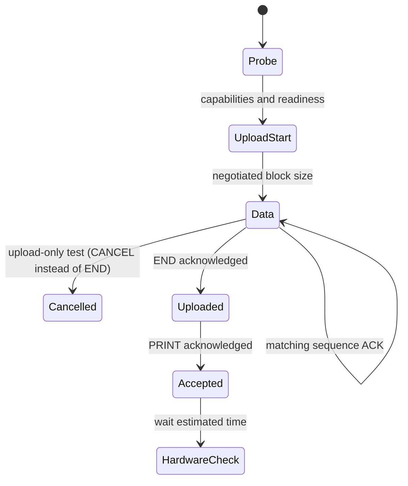

# INSTAX Link protocol

The wire protocol as OutStax implements it, for contributors. It covers what the
Android apps and printer firmware were seen to do. Behaviour marked unknown has
not been confirmed, and only the original mini Link has been tested on hardware.

## Transport

BLE uses:

| Purpose | UUID |
|---|---|
| Service | `70954782-2d83-473d-9e5f-81e1d02d5273` |
| Client writes | `70954783-2d83-473d-9e5f-81e1d02d5273` |
| Printer notifications | `70954784-2d83-473d-9e5f-81e1d02d5273` |

The app selects write-without-response. Responses arrive on the notification
characteristic. Protocol frames and ATT writes have different boundaries:
split a frame to the permitted GATT payload, then reassemble printer bytes by
the declared protocol length. The implementation uses conservative 20-byte
writes by default. Larger writes must fit the connection's negotiated ATT MTU,
which `--write-size` does not negotiate.

Some devices expose a Classic/RFCOMM endpoint as well as the BLE endpoint.
Android's selected transport can differ from iOS. The Rust backend currently
uses BLE, and a diagnostic TCP bridge can carry the same framing. Legacy
SHARE printers use a different Wi-Fi protocol, not this TCP bridge mode.

## Envelope

| Offset | Bytes | Field |
|---|---|---|
| 0 | 2 | Request `41 62` (`Ab`), response `61 42` (`aB`) |
| 2 | 2 | Total frame length, unsigned big-endian |
| 4 | 1 | Command group |
| 5 | 1 | Command operation |
| 6 | variable | Request payload (a response begins with the result code) |
| last | 1 | One's complement of the preceding byte sum modulo 256 |

Request length is `7 + payload_length`. A response adds a result byte, so its
minimum length is 8. A valid complete frame sums to `0xff` modulo 256.
Result `0` is success. Other codes are device errors, not successful ACKs.
In particular a PRINT payload byte such as 12, 15 or 16 is a time estimate
after result=0, not an error status at byte 6.

Examples:

```text
41 62 00 08 00 02 00 52       image-support query
41 62 00 07 10 80 c5          physical PRINT request
61 42 00 0c 10 00 00 00 00 03 84 b9
                               START ACK: success, block size 900
```

The envelope codec preserves unknown opcodes, rejects bad checksums/lengths,
and supports fragmented/coalesced frames. The session permits one outstanding
request and matches command and information selector. Transfer ACK sequence
numbers are validated. There is no general transaction identifier, so an
uncertain session is disconnected rather than retried.

## Information commands

`0000` queries supported functions and information structure versions.
The response success body has eight one-byte fields: function bitmap, device
info version, image info version, battery version, printer-function version,
printer-history version, camera-function version, camera-history version.
This version response is documented but not currently used for feature gating.

`0001` takes a one-byte device information selector. The success body is:
`selector:u8, text_length:u8, text:[u8;text_length]`. Selectors 0–8 are
manufacturer, model, serial, hardware revision, firmware revision, software
revision, system ID, regulatory data and PnP ID. Non-text selectors should not
be interpreted as human-readable strings without checking their encoding.

`0002` takes one selector:

| Selector | Meaning | Body after echoed selector |
|---|---|---|
| 0 | Image support | `width:u16, height:u16, picture_types:u8, options:u8, max_bytes:u32` |
| 1 | Battery | `level_info:u8, capacity_percent:u8, charger_type:u8, charger_state:u8` |
| 2 | Printer function/status | `film_flags:u8, state_flags:u8, print_result:u8, wait_seconds:u8, error_bits:u32` |
| 3 | Print history | `total_prints:u32, total_cover_ejections:u32` |
| 4 | Camera function | Camera-specific fields, not implemented |
| 5 | Camera history | Camera-specific fields, not implemented |

For the newer Mini image response with total frame length exactly 23, the app
reads an additional option-2 byte immediately after `max_bytes`. The remaining
bytes are not assigned a meaning here. Option-2 bit 0 advertises double-density
printing. If the extension is absent, the Rust client does not enable that mode.

Picture type bit `0x02` advertises JPEG. Option bit `0x08` advertises 3D LUT.
Known normal image dimensions are Mini 600×800, Square 800×800, Wide 1260×840.
Dimensions alone identify a film geometry, not a model or firmware revision.
Do not replace the printer's reported maximum with the 105 KiB limit used by
some public clients.

`film_flags & 0x0f` is film remaining. Bit 7 is charging, and bits 4–6 carry a
battery-level field. In `state_flags`, bit 0 means cover open, bit 1 operation
active, bit 2 error, and bits 4–7 give operation information. Print result 0
is normal termination, 1 cover open, 2 no film, 127 processing, 240 error.
The app also runs model-specific readiness checks, and the Rust status
preflight does not replace every one of them.

`0010` in the newer Mini app takes selectors for serial/SSID, light pen,
brightness and Bluetooth/MAC identity. It is distinct from `0001`.
Only selector 1 (light pen) is sent, to SP-4 only: a reply text starting
with `AD` or not 14 bytes long is a FUTABA head, otherwise TOHOKU. SP-4 over
Classic with firmware digits >= 103 also runs `3080`/`3081` head calibration
before START. The apps skip it over BLE.

## BLE connection parameters

`0103` request body:

```text
00 0c 00 0c 00 00 01 90
```

These are four big-endian 16-bit values: 12, 12, 0, 400. Both the current Mini
and Wide transfer tasks send this before image transfer when using BLE.
The Rust session does the same for its BLE transport. The precise effect on
each older firmware still requires hardware verification.

## Image transfer and PRINT

1. Send `1000` with `picture_type:u8, option1:u8, option2:u8, reserved:u8,
   jpeg_length:u32`. JPEG type is 2. Plain mode uses `[2,0,0,0]`.
2. Parse success plus `block_size:u32` from the START reply. Reject impossible
   block sizes. Do not derive the block size from the film format.
3. Send `1001` body `sequence:u32, data:[u8;block_size]`. Sequence starts at 0.
   Pad the final data block with zeroes. The START length is the actual JPEG
   length, excluding this padding.
4. Each DATA reply supplies the acknowledged sequence as `u32`. Send the next
   block only after the matching ACK.
5. Send empty `1002` (END) and await success.
6. To print, send empty `1080` once. The success body begins with an estimated
   completion time in seconds. An ACK is not proof of successful ejection.
7. `1003` cancels an upload that is still open: after at least one DATA and
   before END. The apps send it only on a user cancel between START and END.
   On mini Link firmware 0104 the handler requires transfer state 2, which END
   clears, so `1003` after END returns `0x82` SEQUENCE_ERROR (seen on hardware,
   2026-11-13). Upload-only tests therefore send all DATA blocks and then `1003`
   instead of END, so nothing stays staged.

Main physical workflow:



The official Android PrintTask polls `0002/2` once per second after PRINT.
Result C2 means keep polling without parsing a success body. With result 00,
parse printer readiness with the in-print flag, tolerate busy, and complete when
the operation bit clears. Zero film is valid after the last exposure. The Rust
client now follows that flow with a finite deadline and never replays PRINT.
It also re-reads status before upload and again after END before PRINT. The
WIDE2 official Windows driver's IL independently corroborates both checks.

## Rich processing

The shared `20210701_3DLUT.bin` asset has 16,777,216 records of four bytes.
For each 8-bit RGB input, index `(R << 16) | (G << 8) | B`. Ignore record byte
0 and use bytes 1,2,3 as output RGB. The whole table is exactly 67,108,864
bytes. Its SHA-256 is
`9bc33b49082d9359f677094d8fa10343da54b3c07654c24d88a6f5a039f82092`
in all three acquired base APKs.

The app transforms pixels on the host, then sends option1 `0x08` to indicate
LUT processing has already been applied. Setting that flag on an unprocessed
JPEG is not Rich parity. The independent client supports a local table via
`--lut`, but the table is not shipped in this source bundle. No vendor licence
keys or licence-validation bypass are part of this implementation.

## Design Print / double density

Mini option2 `0x01` selects double density. The app tests the advertised
option-2 support before sending it. For Mini Link+ it composes at 1200×1600,
performs image processing, then halves width to create a 600×1600 JPEG.
This anisotropic raster maps to a print with the normal physical aspect.

The native `rotateAndCropBitmap` routine in `libsharpness.so` was inspected at
ARM64 symbol address `0x805c`. The caller supplies interpolation=2, angle=-0.5,
and the current bitmap width/height. The routine resizes to cover, crops to the
requested rectangle, negates the angle, constructs an OpenCV rotation matrix
around the image center and calls `warpAffine` with cubic interpolation and
constant-zero border. The independent implementation follows the positive
0.5-degree geometry and horizontal squeeze. It does not claim OpenCV's exact
fixed-point coefficient rounding or Android's exact JPEG output.

The separate optional unsharp filter is a different JNI entry point. Its
linear-light, threshold-mask algorithm has been traced and independently ported
in client/sharpness.rs, and `prepare --unsharp` selects it. Exact native numerical
equivalence has not been established. No physical Design Print has been made in this session.

## Other recovered payload layouts

All multibyte fields below are big endian. The layouts are documented facts.
They do not mean a ready-to-use client feature exists for every row.

| Opcode | Request body |
|---|---|
| `0102` auto sleep | `mode:u8, 0,0,0, timer1:u16, timer2:u16, timer3:u16, timer4:u16` |
| `2000` main firmware start | `file_bytes:u32, write_address:u32` |
| `2001` main firmware data | `sequence:u32, data...` |
| `20a0` Bluetooth firmware start | `component_id:u16, file_bytes:u32, complement_byte_sum:u32, reserved:u16` |
| `20a1` Bluetooth firmware data | `sequence:u32, data...` |
| `3000` axes | Empty request, response has `x:i16,y:i16,z:i16,switches:u8` |
| `3001` LED pattern | `when:u8,count:u8,time_in_10ms:u8,repeat:u8,BGR triples...` |
| `3002` device settings | `02, flags:u8`, where flags include power-off and reprint controls |
| `3003` dual LED pattern | Mode/count/timing/repeat, then BGR channels interleaved per step (1 Link+, 2 older dual builder, 3 Link 3) |
| `3004` power LED setting | Mode 1 read / 5 write, reserved fields and LED value, 16-byte body |
| `3010` additional info | One-byte selector, then voltage/temperature or color/history fields |
| `3008` function button (SQUARE) | `02, action:u8` (0 none, 1 reprint). Sent as `02 01` on every SQUARE connect |
| `3020` parameter write | `parameter:u8,mode:u8,dt0..dt7`. The app sends it only to Link 3 (FI033), only with mode 2 (set), and only for parameters 0 (mode switch) and 3 (shooting light). Modes 0/1 are never sent |
| `3081` head correction | `red:u16,green:u16,blue:u16` |
| `8000` camera setting | `flash:u8,timer:u8,0,0` |
| `8001` camera setting read | One-byte selector |
| `8300` camera frame start | `picture_type:u8,frame_number:u8,frame_type:u8,0,image_bytes:u32` |
| `8301` camera frame data | `sequence:u32,data...` |
| `8303` camera frame name | `frame_number:u8,name_length:u8,name_bytes...` |

[`data/protocol/commands.json`](../data/protocol/commands.json) enumerates all 74 distinct command identifiers recovered
from the current Mini and Wide enums, including main/Bluetooth firmware,
camera live view, URL media operations and logs. Enum presence does not prove
that an attached printer supports the command. Offline firmware parsers and
packet builders exist, but there is no firmware updater.

## Open questions

- Confirm the actual response extensions and byte limits for Mini Link+,
  Link WIDE 2 and regional editions, using physical hardware.
- Qualify BLE fragmentation/timing on each OS and firmware.
- Establish reliable print completion without causing processing failures.
- Compare JPEG orientation, head-calibration behavior, auto-enhancement and
  Design/Rich output against the official app on actual film.
- Complete Bluetooth Classic, Wi-Fi SHARE, mobile lifecycle integration,
  firmware recovery, AR and online-service feature parity.

Public references consulted: Fujifilm product/support/driver pages,
`javl/InstaxBLE`, `paorin/InstaxLink`, `dgwilson/ESP32-Instax-Bridge`, Android
AOSP Bluetooth logging documentation, and btleplug's official repository.
